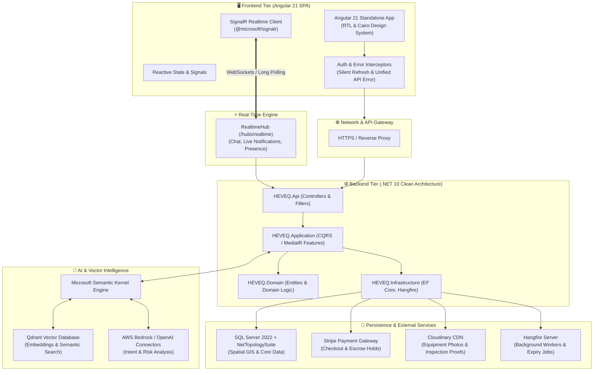
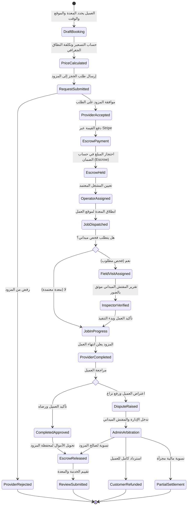

<div align="center">

# 🚜 HEVEQ | هيڤيك
### Enterprise Heavy Equipment Rental, Marketplace & Industrial Services Platform
#### المنصة الرقمية السحابية المتكاملة لحجز وبيع وتأجير المعدات الثقيلة والخدمات الإنشائية

---

[](https://angular.dev/)
[](https://www.typescriptlang.org/)
[](https://dotnet.microsoft.com/)
[](https://learn.microsoft.com/en-us/semantic-kernel/)
[](https://qdrant.tech/)
[](https://dotnet.microsoft.com/apps/aspnet/signalr)
[](https://stripe.com/)
[](https://vitest.dev/)
[](https://opensource.org/licenses/MIT)

<br/>

<p align="center">
  <a href="#overview"><b>🌐 نظرة عامة</b></a> •
  <a href="#features"><b>✨ المميزات</b></a> •
  <a href="#architecture"><b>🏗️ المعمارية البرمجية</b></a> •
  <a href="#workflows"><b>🔄 مسارات العمل</b></a> •
  <a href="#roles"><b>👥 بوابات الأدوار</b></a> •
  <a href="#deep-tech"><b>🧠 التقنيات المتقدمة</b></a> •
  <a href="#structure"><b>📂 هيكل المشروع</b></a> •
  <a href="#quick-start"><b>🚀 التثبيت والتشغيل</b></a> •
  <a href="#api-specs"><b>🔌 واجهات API</b></a> •
  <a href="#faq"><b>❓ الأسئلة الشائعة</b></a>
</p>

</div>

---

<a id="overview"></a>
## 📌 Executive Summary | نبذة تنفيذية

**HEVEQ (هيڤيك)** هي منصة سحابية رائدة ومصممة خصيصاً لقطاع الإنشاءات والمقاولات والصناعات الثقيلة في الشرق الأوسط وشمال أفريقيا (MENA). تجمع المنصة بين **سوق رقمي حر (Marketplace)** لبيع وشراء المعدات ومعدات الصيانة وقطع الغيار، و**نظام حجز وتشغيل للمعدات الثقيلة (On-Demand Machinery Rental & Services)** بالساعة أو اليوم، مدعوماً بمشغلين فنيين معتمدين (Certified Operators)، ونظام ضمان مالي وإسكرو ذكي (Stripe Escrow)، وتفتيش ميداني واقعي (Field Inspections)، ومحرك بحث دلالي فائق الذكاء مدعوم بالذكاء الاصطناعي (Semantic AI Search).

> [!IMPORTANT]
> صُمم تطبيق الواجهة الأمامية (Frontend) باستخدام أحدث معايير **Angular 21** بنمط المكونات المستقلة (*Standalone Components*)، مع دعم كامل للغة العربية والاتجاه من اليمين إلى اليسار (*RTL Native*)، وخط كود *Cairo* الحديث، وإدارة حالة ديناميكية سريعة فائقة الأداء عبر *Signals* و *SignalR WebSockets*.

---

<a id="features"></a>
## ✨ Key Features | المميزات الرئيسية

<table>
  <tr>
    <td width="50%">
      <h3>🚜 تأجير وحجز المعدات الثقيلة</h3>
      <ul>
        <li>حجز آلات ثقيلة (حفارات، أوناش، لوادر، بلدوزرات، قلابات) بالساعة أو باليوم.</li>
        <li>تحديد الموقع الجغرافي الدقيق لموقع العمل مع حساب تلقائي للمسافات ورسوم العمل خارج النطاق (Out-of-zone Surcharges).</li>
        <li>طلب معدة مع مشغل معتمد أو بدون مشغل مع مراجعة رخص وخبرات السائقين.</li>
      </ul>
    </td>
    <td width="50%">
      <h3>🛒 سوق المعدات وقطع الغيار (Marketplace)</h3>
      <ul>
        <li>بيع وشراء المعدات الجديدة والمستعملة مع معايير فحص شفافة.</li>
        <li>نظام فحص ذكاء اصطناعي لتقييم مخاطر الإعلانات تلقائياً (AI Risk Score & Flags).</li>
        <li>طرق دفع مرنة وحجز بالضمان المالي (Escrow Protection).</li>
      </ul>
    </td>
  </tr>
  <tr>
    <td width="50%">
      <h3>🛡️ الضمان المالي والإسكرو (Escrow Protection)</h3>
      <ul>
        <li>حجز المبلغ كاملاً في حساب وسيط عبر <b>Stripe</b> حتى اكتمال العمل.</li>
        <li>حماية العميل والمزود مع نظام تحكيم في النزاعات (Dispute Resolution).</li>
        <li>إمكانية التسوية الجزئية (Partial Settlement) أو الاسترداد الكامل بقرار الإدارة.</li>
      </ul>
    </td>
    <td width="50%">
      <h3>🔍 الفحص والتحقق الميداني (Field Inspections)</h3>
      <ul>
        <li>إرسال مفتشين ميدانيين (Field Inspectors) لمواقع المعدات قبل وأثناء التنفيذ.</li>
        <li>رفع تقارير فحص مدعومة بالصور وإحداثيات الموقع (GPS Verification).</li>
        <li>تأكيد إنجاز المهمة ميدانياً لفض النزاعات وتأكيد جودة الخدمة.</li>
      </ul>
    </td>
  </tr>
  <tr>
    <td width="50%">
      <h3>🤖 محرك بحث دلالي ذكي (AI Semantic Search)</h3>
      <ul>
        <li>فهم لغة المقاول العامية باللغتين العربية والإنجليزية.</li>
        <li>تحليل النية (Intent Parsing) وتوليد أسئلة توضيحية في حال غموض الطلب.</li>
        <li>مطابقة متقدمة عبر تضمينات المتجهات <b>Qdrant Vector DB</b> مع تقييم درجة التطابق.</li>
      </ul>
    </td>
    <td width="50%">
      <h3>⚡ اتصالات فورية متزامنة (Real-time SignalR)</h3>
      <ul>
        <li>محادثات فورية مشفرة بين العميل ومزود الخدمة.</li>
        <li>إشعارات حية وفورية بتغير حالات الحجز، عروض الأسعار، وتأكيد الدفع.</li>
        <li>إعادة اتصال تلقائي سلس عند انقطاع الإنترنت.</li>
      </ul>
    </td>
  </tr>
</table>

---

<a id="architecture"></a>
## 🏗️ System Architecture | المعمارية البرمجية

يعتمد نظام **HEVEQ** على معمارية معاصرة ومفصولة تماماً (Decoupled Modern Architecture)، حيث تتصل واجهة المستخدم المبنية بـ **Angular 21** بنواة خلفية قوية مبنية بـ **.NET 10 Web API** وفق مبادئ *Clean Architecture*:



---

<a id="workflows"></a>
## 🔄 Core Workflows | مسارات العمل الحيوية

### 1. دورة حياة حجز المعدات والضمان المالي (Booking & Escrow Lifecycle)



---

<a id="roles"></a>
## 👥 Role-Based Portals | بوابات الأدوار والصلاحيات

تحتوي المنصة على منظومة تحكم دقيقة بالصلاحيات (RBAC) مدعومة بـ Guards وموجهات تتيح خمس تجارب متخصصة:

```mermaid
graph LR
    User([المستخدم]) --> CheckAuth{تسجيل الدخول؟}
    CheckAuth -->|زائر غير مسجل| PublicPortal["🌐 البوابة العامة (Public)"]
    CheckAuth -->|مسجل| CheckRole{الرتبة والدور (Role)}
    
    CheckRole -->|Customer| CustomerPortal["👷 بوابة العملاء والمقاولين"]
    CheckRole -->|Provider| ProviderPortal["🚜 بوابة مزودي المعدات"]
    CheckRole -->|Employee| EmployeePortal["🔍 بوابة الفحص الميداني"]
    CheckRole -->|Admin| AdminPortal["🛡️ لوحة التحكم والإدارة"]
```

<details>
<summary><b>🌐 1. البوابة العامة ومحركات الاستكشاف (Public Portal)</b> — <i>اضغط للتفاصيل</i></summary>
<br>

* **الصفحة الرئيسية التفاعلية (`/`)**: واجهة ترحيبية تعرض شرائح المعدات، الفئات الأكثر طلباً، ومؤشرات الأمان والضمان.
* **كتالوج الخدمات (`/services`)**: استعراض آلاف المعدات المتاحة للإيجار مع تصفيات دقيقة حسب الفئة، المدينة، السعر بالساعة، والتقييم.
* **السوق المفتوح (`/marketplace`)**: استعراض وبيع المعدات وقطع الغيار الجديدة والمستعملة مع صور وفيديوهات حية.
* **صفحة تفاصيل الخدمة والمعدة (`/service-details/:id` & `/product-details/:id`)**: مواصفات هندسية دقيقة، شروط الاستخدام، كروت المشغلين، ومراجعات العملاء السابقين.
* **البحث الموحد والذكي (`/search-results`)**: نتائج بحث لحظية متزامنة بين الخدمات وسوق البيع.

</details>

<details>
<summary><b>👷 2. بوابة العملاء والمقاولين (Customer Portal)</b> — <i>اضغط للتفاصيل</i></summary>
<br>

* **لوحة تحكم العميل (`/dashboard`)**: إحصائيات سريعة، الحجوزات الجارية، الرصيد المتاح، وتنبيهات الإجراءات المطلوبة.
* **معالج الحجز الذكي (`/create-booking/:id`)**: حساب المدة التقديرية، تحديد متطلبات السلامة وتصاريح الدخول للموقع، وتحديد العنوان بدقة.
* **سجل ومتابعة الحجوزات (`/bookings`)**: تتبع حالات الحجز خطوة بخطوة من القبول حتى الانتهاء، مع خيارات رفع الشكاوى أو تأكيد استلام العمل.
* **طلبات السوق ومتابعة الدفع (`/marketplace-orders`)**: تتبع شحن واستلام قطع الغيار والمعدات المشتراة وإتمام الدفع بأمان.
* **المحفظة الرقمية (`/wallet`)**: إيداع، سحب، واستعراض سجل المعاملات المالية والمبالغ المحتجزة في الإسكرو.
* **المحادثات الفورية (`/messages`)**: محادثة حية مع المزودين والمشغلين لمتابعة وصول المعدة في الوقت الفعلي.
* **التقييمات والدعم الفني (`/reviews`, `/support-tickets`)**: تقييم المعدة والسائق بعد الانتهاء، وفتح تذاكر دعم فني فورية.

</details>

<details>
<summary><b>🚜 3. بوابة مزودي ومالكي المعدات (Provider Portal)</b> — <i>اضغط للتفاصيل</i></summary>
<br>

* **لوحة تحكم المزود (`/provider-dashboard`)**: مؤشرات الأداء المالي، نسبة تشغيل الأسطول (Fleet Utilization Rate)، والأرباح الشهرية.
* **إدارة طلبات الحجز الواردة (`/booking-requests`)**: مراجعة تفاصيل موقع المشروع، مسافة النطاق الجغرافي، قبول الطلب أو رفضه.
* **إدارة الأسطول والإعلانات (`/equipment`, `/create-listing`)**: إضافة معدات جديدة بمواصفات تقنية دقيقة، صور متعددة، وأسعار متغيرة (ساعة/يوم/أسبوع).
* **إدارة المشغلين والفنيين (`/operators`)**: إضافة سجلات سائقي وموجهي المعدات، توثيق رخص القيادة وشهادات السلامة المهنية، وتعيينهم على الحجوزات.
* **المهام النشطة والجدول الزمني (`/active-jobs`, `/provider-bookings`)**: تقويم تفاعلي للمعدات لتجنب تعارض المواعيد وجدولة الصيانة.
* **إدارة مبيعات السوق والأرباح (`/marketplace-sales`, `/earnings`)**: متابعة طلبات الشراء، تحويل الأرباح إلى الحسابات البنكية بعد فك الإسكرو.

</details>

<details>
<summary><b>🔍 4. بوابة موظفي ومفتشي الفحص الميداني (Employee / Field Inspector)</b> — <i>اضغط للتفاصيل</i></summary>
<br>

* **قائمة الزيارات الميدانية المكلف بها (`/employee/field-visits`)**: جدول مهام الفحص في مواقع العمل والمشاريع.
* **تحديث مسار الفحص الميداني**: تغيير حالة الزيارة (`Dispatched` ➔ `OnSite` ➔ `Completed` ➔ `FailedAccess`).
* **توثيق الأدلة والفحص الفني**: رفع صور حية للمعدة أثناء التشغيل، قراءة عداد الساعات، والتأكد من تطابق الهوية والمشغل.
* **إصدار القرار الفني الرسمي**: تسجيل التقرير باختيار أحد المخرجات المعتمدة (`JobConfirmed`, `JobNotConfirmed`, `PartiallyConfirmed`, `Inconclusive`).

</details>

<details>
<summary><b>🛡️ 5. لوحة الإدارة والتحكم الشاملة (Admin Portal)</b> — <i>اضغط للتفاصيل</i></summary>
<br>

* **لوحة المؤشرات والتحليلات (`/admin`)**: نظرة شاملة على حجم التداول المالي، الحجوزات النشطة، والنزاعات المفتوحة.
* **إدارة المستخدمين والصلاحيات (`/admin/users`)**: تفعيل، إيقاف، وترقية الحسابات وتعيين الأدوار (Admin, Employee, Provider, Customer).
* **مراجعة الإعلانات وفحص المخاطر (`/admin/listing-review`)**: فحص الإعلانات الجديدة ومراجعة مؤشر المخاطر المستخرج بالذكاء الاصطناعي (AI Risk Score).
* **توثيق الهويات والشركات (`/admin/account-verifications`, `/admin/documents`)**: مراجعة السجلات التجارية، البطاقات الضريبية، ورخص القيادة للمزودين (KYC).
* **غرفة فض النزاعات والإسكرو (`/admin/disputes`)**: فض الخلافات المالية بين الأطراف، اتخاذ قرار صرف المستحقات، أو استردادها للعميل، أو التسوية الودية.
* **مركز التذاكر والتقييمات (`/admin/tickets`, `/admin/reviews`)**: إدارة شكاوى العملاء ومراقبة التقييمات وحذف التعليقات غير اللائقة.

</details>

---

<a id="deep-tech"></a>
## 🧠 Deep Tech Innovations | التقنيات المتقدمة

```
┌────────────────────────────────────────────────────────────────────────┐
│                        HEVEQ CORE TECH MATRIX                          │
├───────────────────────┬───────────────────────┬────────────────────────┤
│   AI & SEMANTIC CORE  │  SPATIAL & LOGISTICS  │   REALTIME & SECURITY  │
├───────────────────────┼───────────────────────┼────────────────────────┤
│ • Semantic Kernel     │ • NetTopologySuite    │ • SignalR WebSockets   │
│ • Qdrant Vector DB    │ • Out-of-Zone Calc    │ • Stripe Escrow Hold   │
│ • Multi-turn Clarify  │ • GPS Site Geocoding  │ • JWT + Auto-Refresh   │
│ • Fraud Risk Analysis │ • Google Maps Route   │ • RBAC Protected Guard │
└───────────────────────┴───────────────────────┴────────────────────────┘
```

### 1. محرك الذكاء الاصطناعي والبحث الدلالي (Semantic Kernel & Qdrant)
لا يقتصر البحث في HEVEQ على مطابقة النصوص التقليدية (Keyword Search)، بل يعتمد على محرك ذكاء اصطناعي يفهم متطلبات المشروع المعقدة:
* **استخراج القصد (Intent Parsing)**: يتعرف النظام تلقائياً على ما إذا كان العميل يريد "تأجير خدمة حفر" أم "شراء لودر مستعمل"، ويستخلص نوع المعدة، والمدينة، والمدة.
* **حوار التوضيح الذكي (Clarification Loop)**: إذا كتب المستخدم طلباً غامضاً مثل *"محتاج ونش بكره"*, يقوم الذكاء الاصطناعي بمطالبته بتحديد الحمولة المطلوبة وموقع الرفع قبل إظهار النتائج.
* **مطابقة المتجهات الدلالية (Vector Similarity)**: تحويل مواصفات المعدات لمتجهات في **Qdrant DB** لتقديم اقتراحات فائقة الدقة مرتبة بنسبة مئوية ومرفقة بتفسير سبب المطابقة (*Match Explanation*).
* **تحليل مخاطر الإعلانات (AI Risk Engine)**: فحص تلقائي للإعلانات لاكتشاف التناقضات السعرية أو المواصفات غير المنطقية لتقليل عمليات الاحتيال قبل وصولها للإدارة.

### 2. نظام التوزيع الجغرافي وحساب النطاقات (Spatial Dispatching)
* يعتمد النظام على **NetTopologySuite** لمعالجة الإحداثيات المكانية لمواقع المعدات والمشاريع بدقة بالغة.
* حساب المسافة الدائرية ومسار الطريق تلقائياً لاحتساب تكاليف النقل الإضافية (*Out-of-zone Surcharges*) إذا كان موقع العمل يقع خارج النطاق المجاني لخدمة المزود.
* توليد روابط خرائط جغرافية تفاعلية (*Map Links*) للمشغلين للوصول للموقع عبر Google Maps بضغطة زر.

### 3. الاتصال اللحظي وإعادة الاتصال التلقائي (SignalR WebSockets)
* قناة اتصال مشفرة عبر **SignalR Hub** معتمدة على توثيق JWT Bearer.
* إرسال واستقبال الرسائل الفورية مع مؤشرات القراءة وحالة التواجد (Typing & Presence).
* إشعارات فورية بالصوت والرسائل المنبثقة (Toast Notifications) لأي تحديثات على الحجوزات والمدفوعات دون الحاجة لإعادة تحميل الصفحة.

---

<a id="structure"></a>
## 📂 Project Structure | هيكل المشروع الكامل

```
HEVEQ/
├── Backend/                         # نواة الـ Backend المبنية بـ .NET 10 Clean Architecture
│   ├── HEVEQ.Api/                   # واجهات الـ REST Controllers و SignalR Hubs
│   ├── HEVEQ.Application/           # منطق الأعمال، CQRS، DTOs، وتطبيقات Semantic Kernel
│   ├── HEVEQ.Domain/                # الكيانات (Entities)، الـ Enums، والقواعد الجوهرية
│   ├── HEVEQ.Infrastructure/        # EF Core، Qdrant Vector Client، Stripe، و Cloudinary
│   └── HEVEQ.Tests/                 # اختبارات الوحدات والتكامل
│
└── Frontend/                        # واجهة المستخدم المبنية بـ Angular 21 (RTL & Cairo)
    ├── public/                      # الأصول العامة الثابتة والأيقونات
    ├── src/
    │   ├── app/
    │   │   ├── app.config.ts        # موفري التطبيق والموجهات والـ Interceptors
    │   │   ├── app.routes.ts        # مصفوفة المسارات الشاملة وحراس الصلاحيات (Guards)
    │   │   ├── app.ts               # المكون الجذري للتطبيق
    │   │   │
    │   │   ├── core/                # الخدمات، النماذج، والاعتراضات الأساسية
    │   │   │   ├── constants/       # ثوابت عناوين الـ API ومسارات Hubs
    │   │   │   ├── guards/          # حراس المسارات (authGuard, roleGuard)
    │   │   │   ├── helpers/         # دوال المساعدة للخرائط والرسائل
    │   │   │   ├── interceptors/    # معالجات الطلبات (Auth, Error Normalization, UI Refresh)
    │   │   │   ├── models/          # نماذج TypeScript لجميع كيانات النظام
    │   │   │   └── services/        # خدمات الـ HTTP والـ SignalR والتخزين
    │   │   │
    │   │   ├── layout/              # مكونات الهيكل العام
    │   │   │   ├── navbar/          # شريط التنقل العلوي المتجاوب
    │   │   │   ├── sidebar/         # القائمة الجانبية المخصصة للأدوار
    │   │   │   ├── footer/          # التذييل ومعلومات المنصة
    │   │   │   └── toast-host/      # مضيف الإشعارات المنبثقة التفاعلية
    │   │   │
    │   │   ├── pages/               # شاشات وبوابات المنصة
    │   │   │   ├── public/          # الرئيسية، كتالوج الخدمات، والسوق
    │   │   │   ├── auth/            # الدخول، التسجيل، وتأكيد البريد الإلكتروني
    │   │   │   ├── customer/        # لوحة العميل، الحجوزات، المحفظة، المحادثات
    │   │   │   ├── provider/        # لوحة المزود، إدارة الأسطول، المشغلين، الأرباح
    │   │   │   ├── employee/        # الفحص الميداني، توثيق الأدلة بالصور
    │   │   │   └── admin/           # لوحة الإدارة، فض النزاعات، الإسكرو، والتوثيق
    │   │   │
    │   │   └── shared/              # مكونات ومؤشرات قابلة لإعادة الاستخدام
    │   │       ├── action-modal/    # نوافذ التأكيد والحوار المنبثقة
    │   │       ├── empty-state/     # شاشات القوائم الفارغة المتناسقة
    │   │       ├── loading/         # مؤشرات التحميل الدائرية والـ Skeletons
    │   │       ├── pagination/      # شريط الترقيم المتجاوب
    │   │       └── toast/           # خدمة ومكون الرسائل التنبيهية
    │   │
    │   └── assets/                  # ملفات الأنماط والمتغيرات اللونية (CSS Variables)
    │       └── css/                 # base.css, components.css, layouts.css, variables.css
    │
    ├── angular.json                 # إعدادات مترجم ومبني Angular
    ├── package.json                 # حزم وتبيعات المشروع
    ├── tsconfig.json                # إعدادات مترجم TypeScript
    └── README.md                    # دكيومنتيشن المشروع الرسمي
```

---

<a id="quick-start"></a>
## 🚀 Quick Start & Installation | التثبيت والتشغيل المحلي

### المتطلبات الأساسية (Prerequisites)
تأكد من تثبيت الأدوات التالية على بيئة عملك:
* **Node.js**: الإصدار `20.x` أو `22.x LTS`
* **NPM**: الإصدار `10.x` أو أحدث
* **Angular CLI**: الإصدار `21.x` (`npm install -g @angular/cli`)
* **.NET SDK**: الإصدار `10.0` (لتشغيل الـ Backend)
* **SQL Server**: الإصدار `2022` أو أحدث مع دعم NetTopologySuite
* **Qdrant Vector DB** (اختياري عبر Docker لمحرك البحث الذكي)

---

### خطوات تشغيل الواجهة الأمامية (Frontend)

1. **استنساخ المستودع (Clone Repository)**:
   ```bash
   git clone https://github.com/HEVEQ-ITI/Frontend.git
   cd Frontend
   ```

2. **تثبيت الاعتماديات (Install Dependencies)**:
   ```bash
   npm install
   ```

3. **ضبط مسارات الـ API**:
   تأكد من مطابقة مسار الخادم المحلي في الملف:
   [`src/app/core/constants/api.constants.ts`](file:///D:/heveq/Frontend/src/app/core/constants/api.constants.ts)
   ```typescript
   export const API_BASE_URL = 'https://localhost:7100/api';
   export const REALTIME_HUB_URL = 'https://localhost:7100/hubs/realtime';
   ```

4. **بدء خادم التطوير (Start Dev Server)**:
   ```bash
   npm start
   # أو
   ng serve --open
   ```
   افتح المتصفح على: `http://localhost:4200`

5. **تشغيل اختبارات الوحدة (Run Unit Tests with Vitest)**:
   ```bash
   npm test
   ```

6. **بناء النسخة الإنتاجية (Production Build)**:
   ```bash
   npm run build
   ```
   سيتم تصدير ملفات التطبيق المحسنة داخل مجلد `dist/HEVEQ/browser`.

---

<details>
<summary><b>⚙️ خطوات تشغيل الواجهة الخلفية (Backend Setup)</b> — <i>اضغط للتفاصيل</i></summary>
<br>

1. الانتقال لمجلد الـ Backend:
   ```bash
   cd ../Backend/HEVEQ.Api
   ```
2. إعداد المتغيرات في ملف `.env` استناداً إلى `.env.example`:
   * إعداد جملة الاتصال بقاعدة البيانات `DefaultConnection`.
   * مفاتيح `JWT` السرية والـ Issuer.
   * مفاتيح `Stripe:SecretKey` و `Stripe:PublishableKey`.
   * إعدادات `Cloudinary` لرفع الصور والوثائق.
   * مسار ومفاتيح `Qdrant` و `OpenAI` / `AWS Bedrock`.
3. تطبيق الترحيلات على قاعدة البيانات:
   ```bash
   dotnet ef database update --project ../HEVEQ.Infrastructure --startup-project .
   ```
4. تشغيل خادم الـ API:
   ```bash
   dotnet run --launch-profile https
   ```
   سيعمل الـ API على المنفذ: `https://localhost:7100` مع توفر Swagger على `https://localhost:7100/swagger`.

</details>

---

<a id="api-specs"></a>
## 🔌 API & Realtime Hub Specs | واجهات API و SignalR

<details>
<summary><b>📡 نقاط الاتصال الرئيسية (Key REST Endpoints)</b> — <i>اضغط للتوسيع</i></summary>
<br>

| النطاق (Module) | المسار (Endpoint) | الطريقة (Method) | الوصف |
| :--- | :--- | :---: | :--- |
| **Auth** | `/api/Auth/Login` | `POST` | تسجيل الدخول والحصول على JWT & Refresh Token |
| **Auth** | `/api/Auth/Register` | `POST` | إنشاء حساب جديد (Customer / Provider) |
| **Auth** | `/api/Auth/me` | `GET` | جلب بيانات المستخدم الحالي وصلاحياته |
| **AI Search** | `/api/public/ai-search` | `POST` | استعلام البحث الدلالي وتحليل النية التفاعلية |
| **Bookings** | `/api/Bookings` | `POST` | إنشاء طلب حجز جديد لمعدة أو خدمة |
| **Bookings** | `/api/Bookings/my` | `GET` | استعراض حجوزات العميل الحالية والسابقة |
| **Bookings** | `/api/Bookings/{id}/confirm-payment` | `POST` | تأكيد الدفع واحتجاز المبلغ في الإسكرو |
| **Provider** | `/api/provider/dashboard` | `GET` | إحصائيات أداء المزود ومعدلات الحجز |
| **Provider** | `/api/provider/operators` | `GET/POST` | إدارة المشغلين والسائقين التابعين للمزود |
| **Field Visits** | `/api/employee/field-visits/{id}/evidence` | `POST` | رفع صور الفحص الميداني والتقرير الفني |
| **Disputes** | `/api/admin/disputes/bookings/{id}/release-to-provider` | `POST` | فك الإسكرو لصالح المزود بقرار الإدارة |
| **Disputes** | `/api/admin/disputes/bookings/{id}/refund-customer` | `POST` | استرداد الأموال للعميل لعدم إنجاز العمل |

</details>

<details>
<summary><b>⚡ أحداث ومستمعات الـ Realtime Hub (SignalR Specs)</b> — <i>اضغط للتوسيع</i></summary>
<br>

يتصل التطبيق بنقطة اتصال الـ Hub عبر: `https://localhost:7100/hubs/realtime`

| الحدث (Event) | الاتجاه | البايلود (Payload) | الوصف |
| :--- | :---: | :--- | :--- |
| `ReceiveNotification` | Server ➔ Client | `NotificationItem` | تنبيهات لحظية بتغيرات الحجوزات والمدفوعات |
| `ReceiveMessage` | Server ➔ Client | `RealtimeMessage` | رسالة محادثة جديدة بين أطراف الحجز |
| `SendMessage` | Client ➔ Server | `{ conversationId, content }` | إرسال رسالة دردشة فورية |
| `Ping` / `Pong` | Bidirectional | `void` | فحص استمرارية الاتصال بالخادم |

</details>

---

## 🎨 Design System & UI/UX Standards | معايير الواجهة والتصميم

* **هوية الأمان الصناعي (Industrial Safety Palette)**:
  * **اللون الرئيسي (Primary)**: الأصفر الصناعي السلامي (`#F4A300`) المستوحى من معدات كاتربيلر والإنشاءات.
  * **اللون الداكن (Dark)**: الرمادي الكربوني العميق (`#111827`) لإبراز الرصانة الهندسية.
  * **التباين وسهولة القراءة**: متوافق تماماً مع معايير الوصول العالمية **WCAG AAA**.
* **الخط الطباعي (Typography)**:
  * خط **Cairo** المتميز، مع تباعد متوازن وأوزان واضحة تدعم الأرقام والمصطلحات الهندسية بدقة.
* **دعم الوضع المظلم (Dark Mode)**:
  * تبديل سلس يدعم السمة الداكنة عبر متغيرات الـ CSS المتطورة في [`variables.css`](file:///D:/heveq/Frontend/src/assets/css/variables.css).

---

<a id="faq"></a>
## ❓ FAQ & Troubleshooting | الأسئلة الشائعة وحلول المشاكل

<details>
<summary><b>1. تظهر رسالة خطأ CORS عند الاتصال بالـ Backend محلياً، ما الحل؟</b></summary>
<br>

تأكد من إضافة النطاق المحلي للواجهة الأمامية `http://localhost:4200` في إعدادات الـ CORS داخل ملف `Program.cs` في مشروع `HEVEQ.Api`، والسماح بالترويسات وبيانات الاعتماد:
```csharp
builder.Services.AddCors(options => {
    options.AddPolicy("AllowFrontend", policy => policy
        .WithOrigins("http://localhost:4200")
        .AllowAnyHeader()
        .AllowAnyMethod()
        .AllowCredentials());
});
```

</details>

<details>
<summary><b>2. خدمة SignalR لا تتصل وتظهر رسالة خطأ 401 Unauthorized؟</b></summary>
<br>

يتطلب خادم SignalR تمرير توكن الـ JWT عبر استعلام الـ Query `access_token` لأن معايير WebSockets لا تدعم ترويسة `Authorization` المباشرة في المصافحة الأولى. الخدمة في الفرونت إند تضبط هذا تلقائياً عبر:
```typescript
new signalR.HubConnectionBuilder()
  .withUrl(REALTIME_HUB_URL, {
    accessTokenFactory: () => this.tokenStorage.getAccessToken() ?? ''
  })
```
تأكد من تسجيل الدخول أولاً وأن التوكن لم تنتهِ صلاحيته.

</details>

<details>
<summary><b>3. كيف يتم التعامل مع تجديد التوكن الصامت (Silent Token Refresh)؟</b></summary>
<br>

الاعتراض البرمجي [`auth-interceptor.ts`](file:///D:/heveq/Frontend/src/app/core/interceptors/auth-interceptor.ts) يراقب أكواد الخطأ `401 Unauthorized`. عند حدوثها، يتم حجز الطلب مؤقتاً واستدعاء `/api/Auth/refresh-token` تلقائياً باستخدام الـ `RefreshToken`، ثم إعادة إرسال الطلب الأصلي بسلاسة دون أن يشعر المستخدم بانقطاع الجلسة.

</details>

---

## 🤝 Contributing | المساهمة والتطوير

نرحب بمساهمات المطورين لتحسين المنصة! للمساهمة:
1. قم بعمل **Fork** للمستودع.
2. أنشئ فرعاً لميزتك الجديدة:
   ```bash
   git checkout -b feature/AmazingFeature
   ```
3. احفظ التعديلات مع رسالة وصفية واضحة:
   ```bash
   git commit -m "feat: Add smart operator calendar filtering"
   ```
4. ارفع التعديلات للفرع:
   ```bash
   git push origin feature/AmazingFeature
   ```
5. افتح **Pull Request** للمراجعة والدمج.

---

## 📜 License & Acknowledgements | الترخيص والشكر والتقدير

* **الترخيص (License)**: هذا المشروع مرخص تحت رخصة **MIT License** - راجع ملف [LICENSE](LICENSE) لمزيد من التفاصيل.
* **مشروع تخرج معهد تكنولوجيا المعلومات (ITI)**:
  تم تطوير هذا المشروع كنموذج رائد ومتكامل لحلول الرقمنة الصناعية تحت إشراف نخبة من أساتذة وخبراء **Information Technology Institute (ITI)**.

<br>

<div align="center">
  <sub>تم تطوير المنصة بشغف واحترافية بواسطة فريق عمل <b>HEVEQ</b> 🚜💨</sub>
  <br>
  <sub>إذا نال المشروع إعجابك، لا تنسَ منح المستودع نجمة ⭐ على GitHub!</sub>
</div>
